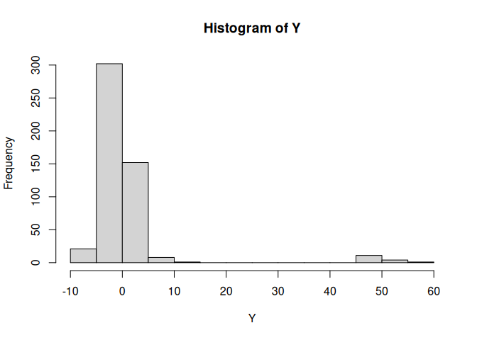
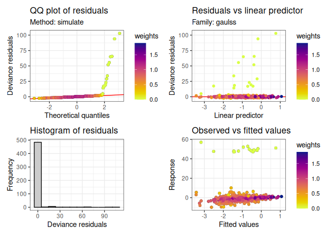

<!-- README.md is generated from README.Rmd. Please edit this file -->

# gddlm: Robust double linear models using gamma divergence

<!-- badges: start -->

[](https://www.tidyverse.org/lifecycle/#experimental)

<!-- badges: end -->

`gddlm` is an `R` package associated with the manuscript “Robust double
linear models using gamma divergence” by
[Hui](https://francishui.netlify.app/), and
[Sugusawa](https://sites.google.com/view/ssugasawa/), which is currently
in preparation.

# Installation

Currently, `gddlm` is available and can be installed from Github with
the help of `pak` package using:

    pak::pkg_install("fhui28/gddlm")

<!-- Alternatively, or if the above does not work, you may download a (hopefully!) stable release of `COQUE` by choosing the latest release on the right hand side of this Github webpage. -->

# Getting started and example usage

Please check the help files for the main `gddlm` and `gddlm_lsa`
functions after installation. Alternatively, you can follow the basic
example below.

``` r
library(tidyverse)
library(mgcv)
library(mvtnorm)
library(gratia)
library(gddlm)
```

Simulate data from a double linear model with (average 5%) outliers in
the response variable

``` r
set.seed(062026)
n <- 500
p <- 10
H <- abs(outer(1:p, 1:p, "-"))
H <- 0.75^H
X <- cbind(1, rmvnorm(n, sigma = H))
Beta_true <- c(-1, -1, 1, -0.5, 0.5, 0.2, -0.2, rep(0, p - 6))
Delta_true <- c(0.5, 0.5, 0, 0, -0.5, 0, 0, 0.25, -0.25, rep(0, p - 8))

## Generate responses
mu_true <- as.vector(X %*% Beta_true)
sig_true <- exp(as.vector(X %*% Delta_true))
Y <- rnorm(n, mean = mu_true, sd = sig_true)

## Create outliers
om <- 0.05
out <- rbinom(n, 1, om)
Y[out==1] <- Y[out==1] + 50

hist(Y, breaks = 20)
```



Fit gamma divergence double linear models, select the gamma tuning
parameter via cross-validation

``` r
make_mu_formula <- paste0("response ~" , paste0("X", 1:p, collapse = " + ")) %>%
    formula
make_sigma_formula <- paste0("~" , paste0("X", 1:p, collapse = " + ")) %>%
    formula

runcv <- cv_gddlm(mu_formula = make_mu_formula,
                  sigma_formula = make_sigma_formula,
                  data = data.frame(response = Y, X[,-1]))
#> Onto fold 1...
#> Onto fold 2...
#> Onto fold 3...
#> Onto fold 4...
#> Onto fold 5...
#> Onto fold 6...
#> Onto fold 7...
#> Onto fold 8...
#> Onto fold 9...
#> Onto fold 10...

fit_gddglm_choosegamma <- gddlm(mu_formula = make_mu_formula,
                                sigma_formula = make_sigma_formula,
                                data = data.frame(response = Y, X[,-1]),
                                gamma_tuning = runcv$gamma_optimal)
```

Demonstration of some of the functions available in the package

``` r
fit_gddglm_choosegamma %>% 
    str
#> List of 16
#>  $ call                : language gddlm(mu_formula = make_mu_formula, sigma_formula = make_sigma_formula,      data = data.frame(response = Y, X[, | __truncated__
#>  $ mu_formula          :Class 'formula'  language response ~ X1 + X2 + X3 + X4 + X5 + X6 + X7 + X8 + X9 + X10
#>   .. ..- attr(*, ".Environment")=<environment: 0x6510dee4e950> 
#>  $ sigma_formula       :Class 'formula'  language ~X1 + X2 + X3 + X4 + X5 + X6 + X7 + X8 + X9 + X10
#>   .. ..- attr(*, ".Environment")=<environment: 0x6510deeb18b8> 
#>  $ model               :'data.frame':    500 obs. of  11 variables:
#>   ..$ response: num [1:500] -1.58 10.06 -1.85 -3.26 -2.56 ...
#>   ..$ X1      : num [1:500] 1.892 0.674 -0.583 0.789 1.244 ...
#>   ..$ X2      : num [1:500] 0.995 1.229 -0.407 -0.667 0.757 ...
#>   ..$ X3      : num [1:500] 1.177 0.14 0.368 -0.295 0.785 ...
#>   ..$ X4      : num [1:500] 0.873 -1.108 -0.143 -1.546 1.28 ...
#>   ..$ X5      : num [1:500] 1.118 -0.349 0.742 -1.604 1.253 ...
#>   ..$ X6      : num [1:500] 1.993 0.897 -0.146 -1.317 0.848 ...
#>   ..$ X7      : num [1:500] 2.237 0.479 -0.235 -1.316 1.426 ...
#>   ..$ X8      : num [1:500] 1.53 -1.364 -0.568 -1.973 -0.406 ...
#>   ..$ X9      : num [1:500] 0.978 -0.65 -0.746 -2.823 -1.585 ...
#>   ..$ X10     : num [1:500] 1.277 -2.057 0.391 -2.11 -0.594 ...
#>  $ mu_coefficients     : Named num [1:11] -1.008 -0.714 0.795 -0.767 0.628 ...
#>   ..- attr(*, "names")= chr [1:11] "(Intercept)" "X1" "X2" "X3" ...
#>  $ sigma_coefficients  : Named num [1:11] 0.5218 0.5593 -0.0182 -0.0566 -0.4533 ...
#>   ..- attr(*, "names")= chr [1:11] "(Intercept)" "X1" "X2" "X3" ...
#>  $ mu_fitted           : num [1:500] -2 -1.59 -1.02 -3.17 -1 ...
#>  $ sigma_fitted        : num [1:500] 3.55 5.61 1.58 6.03 2.98 ...
#>  $ raw_residuals       : num [1:500] 0.4238 11.6476 -0.8268 -0.0924 -1.5523 ...
#>  $ pearson_residuals   : num [1:500] 0.1194 2.077 -0.5239 -0.0153 -0.5205 ...
#>  $ final_weights       : num [1:500] 0.893 0.358 1.133 0.744 0.907 ...
#>  $ gamma_tuning        : num 0.35
#>  $ gamma_divergence    : num -879
#>  $ V_full              : num [1:22, 1:22] 1.02e-02 5.46e-03 1.14e-05 1.52e-04 -5.17e-03 ...
#>   ..- attr(*, "dimnames")=List of 2
#>   .. ..$ : chr [1:22] "(Intercept)" "X1" "X2" "X3" ...
#>   .. ..$ : chr [1:22] "(Intercept)" "X1" "X2" "X3" ...
#>  $ V_mu_coefficients   : num [1:11, 1:11] 1.02e-02 5.46e-03 1.14e-05 1.52e-04 -5.17e-03 ...
#>   ..- attr(*, "dimnames")=List of 2
#>   .. ..$ : chr [1:11] "(Intercept)" "X1" "X2" "X3" ...
#>   .. ..$ : chr [1:11] "(Intercept)" "X1" "X2" "X3" ...
#>  $ V_sigma_coefficients: num [1:11, 1:11] 2.00e-03 3.09e-04 2.73e-04 3.83e-05 -6.35e-04 ...
#>   ..- attr(*, "dimnames")=List of 2
#>   .. ..$ : chr [1:11] "(Intercept)" "X1" "X2" "X3" ...
#>   .. ..$ : chr [1:11] "(Intercept)" "X1" "X2" "X3" ...
#>  - attr(*, "class")= chr "gddlm"

summary(fit_gddglm_choosegamma)
#> Double linear model fitted using gamma divergence with gamma = 0.35 
#> Formula:
#> response ~ X1 + X2 + X3 + X4 + X5 + X6 + X7 + X8 + X9 + X10
#> <environment: 0x6510dee4e950>
#> ~X1 + X2 + X3 + X4 + X5 + X6 + X7 + X8 + X9 + X10
#> <environment: 0x6510deeb18b8>
#> 
#> Parametric coefficients (mu and sigma):
#>                    Estimate Std. Error z value Pr(>|z|)    
#> mu_(Intercept)    -1.008060   0.101094  -9.971  < 2e-16 ***
#> mu_X1             -0.713515   0.095948  -7.436 1.03e-13 ***
#> mu_X2              0.795016   0.105147   7.561 4.00e-14 ***
#> mu_X3             -0.767158   0.115109  -6.665 2.65e-11 ***
#> mu_X4              0.628127   0.125624   5.000 5.73e-07 ***
#> mu_X5              0.319577   0.123739   2.583 0.009804 ** 
#> mu_X6             -0.087774   0.124295  -0.706 0.480080    
#> mu_X7             -0.127017   0.116278  -1.092 0.274678    
#> mu_X8             -0.018457   0.120650  -0.153 0.878416    
#> mu_X9              0.036340   0.120255   0.302 0.762510    
#> mu_X10             0.012260   0.098188   0.125 0.900630    
#> sigma_(Intercept)  0.521790   0.044774  11.654  < 2e-16 ***
#> sigma_X1           0.559314   0.064404   8.684  < 2e-16 ***
#> sigma_X2          -0.018241   0.079314  -0.230 0.818108    
#> sigma_X3          -0.056611   0.079691  -0.710 0.477471    
#> sigma_X4          -0.453271   0.080216  -5.651 1.60e-08 ***
#> sigma_X5           0.056826   0.090392   0.629 0.529571    
#> sigma_X6          -0.066878   0.085940  -0.778 0.436458    
#> sigma_X7           0.291493   0.084689   3.442 0.000578 ***
#> sigma_X8          -0.344956   0.088504  -3.898 9.71e-05 ***
#> sigma_X9           0.004291   0.081395   0.053 0.957959    
#> sigma_X10          0.084587   0.064117   1.319 0.187081    
#> ---
#> Signif. codes:  0 '***' 0.001 '**' 0.01 '*' 0.05 '.' 0.1 ' ' 1
#> 
#> 
#> Residual degrees of freedom: 478 
#> Gamma divergence: -878.8318

appraise(fit_gddglm_choosegamma)
#> Warning: `aes_string()` was deprecated in ggplot2 3.0.0.
#> ℹ Please use tidy evaluation idioms with `aes()`.
#> ℹ See also `vignette("ggplot2-in-packages")` for more information.
#> ℹ The deprecated feature was likely used in the gddlm package.
#>   Please report the issue at <https://github.com/fhui28/gddlm/issues>.
#> This warning is displayed once per session.
#> Call `lifecycle::last_lifecycle_warnings()` to see where this warning was
#> generated.
```



``` r

coef(fit_gddglm_choosegamma)
#> (Intercept)          X1          X2          X3          X4          X5 
#> -1.00805981 -0.71351490  0.79501588 -0.76715837  0.62812689  0.31957701 
#>          X6          X7          X8          X9         X10 
#> -0.08777413 -0.12701708 -0.01845680  0.03633964  0.01226032
coef(fit_gddglm_choosegamma, type = "sigma")
#>  (Intercept)           X1           X2           X3           X4           X5 
#>  0.521789606  0.559313762 -0.018240721 -0.056610769 -0.453271344  0.056825892 
#>           X6           X7           X8           X9          X10 
#> -0.066877656  0.291493211 -0.344956407  0.004290749  0.084586991

simulate(fit_gddglm_choosegamma, nsim = 10) %>% 
    str
#> 'data.frame':    500 obs. of  10 variables:
#>  $ sim_1 : num  -2.38 -7.5 -2.93 -2.79 -2.11 ...
#>  $ sim_2 : num  2.28 2.11 -3.84 11.19 1.87 ...
#>  $ sim_3 : num  -11.39 2.15 -2.44 -11.69 -6.34 ...
#>  $ sim_4 : num  -1.006 -9.068 -2.774 0.548 0.774 ...
#>  $ sim_5 : num  -2.56 1.52 -1.45 -5.18 -5.17 ...
#>  $ sim_6 : num  -5.80865 -10.07043 -0.00196 -6.77687 -3.1056 ...
#>  $ sim_7 : num  -2.848 -4.076 -0.102 1.929 -1.035 ...
#>  $ sim_8 : num  -0.316 -11.571 1.574 -11.66 -2.657 ...
#>  $ sim_9 : num  -1.19 2.89 1.22 -5.32 3.23 ...
#>  $ sim_10: num  -0.171 -6.551 -0.496 -5.883 2.888 ...
#>  - attr(*, "seed")= int [1:626] 10403 80 -1437186727 2126329572 -488913071 -86937626 -1577149416 1537399949 -1012289428 1385622840 ...

predict(fit_gddglm_choosegamma, predictor = "mu", se.fit = TRUE) %>% 
    head
#>          fit    se.fit     lower      upper
#> 1 -2.0005503 0.2485797 -2.487758 -1.5133431
#> 2 -1.5898385 0.3730717 -2.321046 -0.8586313
#> 3 -1.0199697 0.1931697 -1.398575 -0.6413640
#> 4 -3.1685645 0.3203783 -3.796494 -2.5406345
#> 5 -1.0045116 0.2791003 -1.551538 -0.4574850
#> 6 -0.9842505 0.3200514 -1.611540 -0.3569614
predict(fit_gddglm_choosegamma, predictor = "sigma", se.fit = TRUE) %>% 
    head
#>         fit   se.fit     lower    upper
#> 1 3.5479285 1.157207 2.6649635 4.723441
#> 2 5.6077849 1.238756 3.6858907 8.531791
#> 3 1.5782589 1.128559 1.2451817 2.000432
#> 4 6.0256004 1.203386 4.1918896 8.661454
#> 5 2.9820786 1.187822 2.1281830 4.178585
#> 6 0.9294103 1.254137 0.5962867 1.448638
```

# If you find any bugs and issues…

If you find something that looks like a bug/issue, please use Github
issues and post it up there. As much as possible, please include in the
issue:

1.  A description of the bug/issue;
2.  Paste-able code along with some comments that reproduces the problem
    e.g., using the
    [reprex](https://cran.r-project.org/web/packages/reprex/index.html)
    package. If you also have an idea of how to fix the problem, then
    that is also much appreciated.
3.  Required data files etc…

Alternatively, please contact the corresponding author at
<francis.hui@anu.edu.au>
